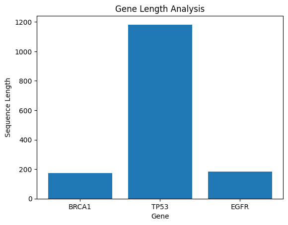
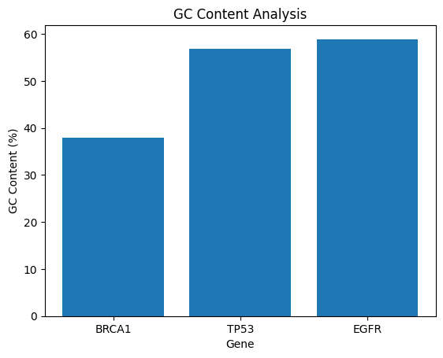

# Computational Analysis of Breast Cancer Genes: GC Content and Gene Length

A small bioinformatics project that retrieves nucleotide sequences for breast cancer-associated genes (**BRCA1, TP53, EGFR**) from NCBI and compares their sequence length and GC content.

Built with Python, Biopython, Pandas, Matplotlib and Google Colab.

## Why GC content and length?

GC content and sequence length are basic genomic features. Differences between genes can relate to sequence stability, regulation and structure, so they are a simple first step in exploring cancer-related genes as possible biomarkers.

## What the script does

1. Searches NCBI (Entrez) for each gene in *Homo sapiens*.
2. Downloads the top nucleotide record as FASTA with Biopython.
3. Calculates sequence length and GC content: `(G + C) / length * 100`.
4. Saves a results table (`disease_genes_analysis.csv`) and two bar plots.

I also ran a wider version on a list of 20 breast cancer-related gene IDs from NCBI Gene, using RefSeq mRNA records, to see the spread of lengths and GC content across genes.

## Results

**Sequence length**



**GC content**



In this run, BRCA1 had the lowest GC content (about 38%), while TP53 and EGFR were higher (about 57% and 59%). TP53 had the longest sequence of the three.

> **Note:** The script takes the first NCBI nucleotide record returned for each gene. That record may be a partial sequence or transcript, not the full gene, so the lengths and GC values illustrate the method and are not definitive gene properties. For rigorous results, select a specific RefSeq accession for each gene.

## How to run

```bash
pip install biopython pandas matplotlib
python disease_gene_analysis.py
```

Before running, open `disease_gene_analysis.py` and set `Entrez.email` to your own email address (NCBI requires it). You can also paste the code into Google Colab.

## Files

| File | Description |
|---|---|
| `disease_gene_analysis.py` | Full analysis script |
| `gene_length_plot.png` | Output: sequence length per gene |
| `gc_content_plot.png` | Output: GC content per gene |

## Tools

Python, Biopython (Entrez, SeqIO), Pandas, Matplotlib, Google Colab, NCBI Nucleotide and Gene databases

## Future work

- Use full RefSeq transcripts or genomic sequences for exact gene lengths
- Add more genes and other cancer types
- Add codon usage, CpG island and k-mer analysis
- Link results to expression or mutation data


